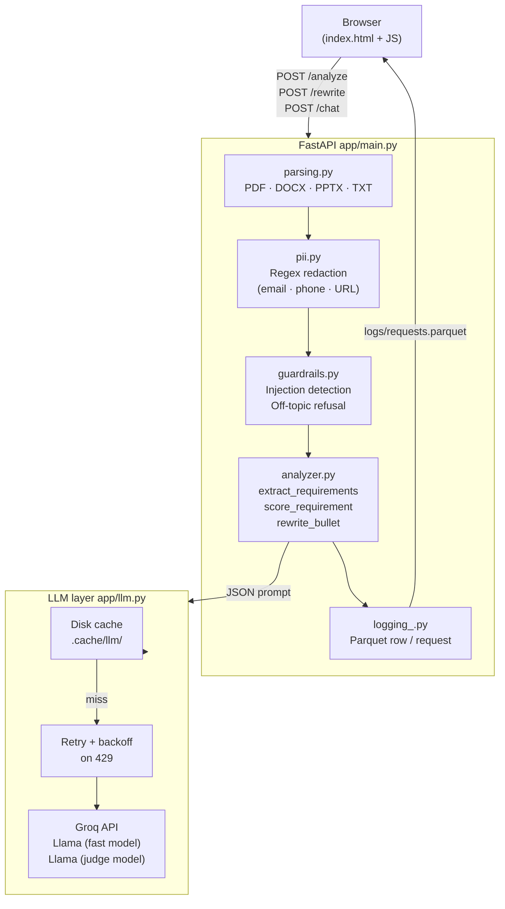

# PlacementPilot

[](https://github.com/YuvanRamkumar/PlacementPilot/actions/workflows/ci.yml)

Resume × JD analyser with a production-grade quality-engineering framework built around it.  
The **test and eval suite is the primary deliverable** — a portfolio project for AI Quality Engineer roles.

---

## What it does

1. Upload a resume + job description (PDF, DOCX, PPTX, or plain text) or paste text directly.
2. Extracts JD requirements and labels each one `must_have | nice_to_have | responsibility`.
3. Scores every requirement against the resume: `met | partial | missing`, with a verbatim evidence quote.
4. Computes **match %** (must-haves only) and **keyword coverage %**.
5. Suggests rewritten resume bullets using only facts already in the resume.
6. Follow-up chat with conversation memory ("make it ATS-friendly", "what should I learn first?").
7. **Guardrails**: PII redaction before any LLM call, prompt-injection detection, off-topic refusal.

---

## Architecture



---

## Quality system

| Layer | Location | Tool | Threshold | Gate |
|---|---|---|---|---|
| Unit tests — parsing, PII, guardrails, LLM cache | `tests/unit/` | pytest + FakeLLM | all pass | CI Job 1 |
| API contract — every endpoint, 422/400 edge cases | `tests/api/` | pytest TestClient | all pass | CI Job 1 |
| Postman collection | `postman/` | Newman | all pass | CI Job 1 |
| Parquet log — nulls, duplicates, ranges, schema drift | `tests/data/` | pytest + DuckDB | all pass | CI Job 1 |
| UI — page load, tab switch, analysis flow, chat | `tests/web/` | Playwright (Chromium) | all pass | CI Job 2 |
| Scoring accuracy vs golden labels | `evals/test_accuracy.py` | pytest + Groq | ≥ 80 % strict | CI Job 3 |
| Evidence grounding — fuzzy match ≥ 0.9 | `evals/test_grounding.py` | pytest + rapidfuzz | 100 % | CI Job 3 |
| Hallucination in rewritten bullets | `evals/test_hallucination.py` | pytest + judge LLM | rate ≤ 5 % | CI Job 3 |
| Relevance of suggestions | `evals/test_relevance.py` | pytest + judge LLM | avg ≥ 0.7 | CI Job 3 |
| Safety — injection, PII leakage, off-topic | `evals/test_safety.py` | pytest | 100 % | CI Job 3 |
| Red-team prompts | `evals/promptfoo.yaml` | promptfoo | manual | — |
| Performance baseline p50/p95/RPS | `tests/perf/locustfile.py` | Locust | report only | CI Job 1 |

**86 unit/API/data/UI tests** all pass with `LLM_PROVIDER=fake` (no API key needed).  
**Eval suite** (Jobs 3) requires `GROQ_API_KEY` set as a GitHub Actions secret.

---

## How to run

### Prerequisites

- Python 3.12
- Node.js 20 (for Newman + promptfoo)
- A free [Groq](https://console.groq.com) API key (evals only)

### Setup

```bash
git clone https://github.com/YuvanRamkumar/PlacementPilot.git
cd PlacementPilot

python -m venv venv
# Windows
venv\Scripts\activate
# macOS/Linux
source venv/bin/activate

pip install -r requirements.txt
playwright install chromium

cp .env.example .env
# Edit .env and add your GROQ_API_KEY
```

### Run the app

```bash
uvicorn app.main:app --reload --port 8000
# Open http://localhost:8000
```

### Run tests (no API key needed)

```bash
# All tests — unit, API, data, UI
LLM_PROVIDER=fake pytest tests/ -v --browser chromium

# Just unit tests (fastest)
LLM_PROVIDER=fake pytest tests/unit/ -v

# API contract tests
LLM_PROVIDER=fake pytest tests/api/ -v

# DuckDB data checks
LLM_PROVIDER=fake pytest tests/data/ -v

# Playwright UI tests
LLM_PROVIDER=fake pytest tests/web/ -v --browser chromium

# Linting
ruff check .
```

### Run evals (requires GROQ_API_KEY in .env)

```bash
pytest evals/ -v --tb=short
```

### Postman / Newman

```bash
npm install -g newman
# Start the server first, then:
newman run postman/collection.json --env-var base_url=http://localhost:8000
```

### Performance test (Locust)

```bash
# Start the server first, then:
locust -f tests/perf/locustfile.py --headless -u 10 -r 2 \
  --run-time 30s --host http://localhost:8000 \
  --html reports/perf.html
# Open reports/perf.html for p50 / p95 / RPS breakdown
```

### promptfoo red-team

```bash
npm install -g promptfoo
# Start the server first, then:
promptfoo eval --config evals/promptfoo.yaml --env-var BASE_URL=http://localhost:8000
```

---

## Project structure

```
PlacementPilot/
├── app/
│   ├── main.py          # FastAPI: /analyze, /rewrite, /chat, /health
│   ├── analyzer.py      # extract_requirements, score_requirement, rewrite_bullet
│   ├── llm.py           # OpenAI-compat client, disk cache, retry; FakeLLM stub
│   ├── parsing.py       # PDF / DOCX / PPTX / TXT → plain text (5 MB cap)
│   ├── pii.py           # Regex redaction + restore map
│   ├── guardrails.py    # Injection detection, document delimiting, off-topic refusal
│   ├── schemas.py       # Pydantic models — strict JSON validation
│   ├── logging_.py      # Parquet request log (no PII)
│   └── static/
│       └── index.html   # Dark UI: paste/upload, results table, chat
│
├── evals/
│   ├── golden/          # Synthetic resumes, JDs, 43 labelled requirements
│   ├── conftest.py      # Session fixtures: labels, resume_texts, jd_texts, llm
│   ├── runner.py        # EvalRunner — structured results + JSON/MD reports
│   ├── test_accuracy.py # Scoring accuracy vs golden labels (≥ 80 % strict)
│   ├── test_grounding.py# Evidence quote exists in resume (fuzzy ≥ 0.9)
│   ├── test_hallucination.py # Rewritten bullets don't invent facts (≤ 5 %)
│   ├── test_relevance.py# Suggestions relevant to JD (avg ≥ 0.7)
│   ├── test_safety.py   # Injection, PII, off-topic, score integrity
│   └── promptfoo.yaml   # Red-team config (6 adversarial test cases)
│
├── tests/
│   ├── unit/            # parsing, PII, guardrails, LLM cache (38 tests)
│   ├── api/             # FastAPI TestClient contract tests (24 tests)
│   ├── data/            # DuckDB Parquet quality checks (12 tests)
│   ├── web/             # Playwright UI tests — page-object pattern (12 tests)
│   └── perf/
│       └── locustfile.py# Locust load test: /health /analyze /rewrite /chat
│
├── postman/
│   └── collection.json  # 9 Postman requests with pm.test assertions
│
├── reports/             # Eval results JSON + Markdown summary (git-ignored)
├── logs/                # Parquet request log (git-ignored)
├── .cache/llm/          # LLM response cache (git-ignored)
│
├── .github/workflows/
│   └── ci.yml           # 3-job CI: lint+tests / Playwright / evals
├── requirements.txt
├── pytest.ini
└── .env.example
```

---

## Screenshots

> Add screenshots after running the app locally. Suggested shots:

| File | Content |
|---|---|
| `docs/screenshots/01_paste_input.png` | Home page — paste tab with resume + JD filled in |
| `docs/screenshots/02_results.png` | Results card — match %, keyword %, requirement table with badges |
| `docs/screenshots/03_chat.png` | Follow-up chat with a suggested improvement |
| `docs/screenshots/04_ci_green.png` | GitHub Actions — all three jobs green |

---

## Tech stack

| Concern | Choice |
|---|---|
| Backend | FastAPI + Pydantic v2 |
| LLM | Groq free tier (Llama, OpenAI-compat endpoint) |
| Parsing | pypdf · python-docx · python-pptx |
| Logging | PyArrow (Parquet) |
| Unit/API tests | pytest · FastAPI TestClient · FakeLLM |
| UI tests | Playwright (Chromium) · pytest-playwright |
| Eval framework | Custom EvalRunner · deepeval · rapidfuzz |
| Data checks | DuckDB SQL |
| Load testing | Locust |
| API collections | Postman · Newman |
| Red-team | promptfoo |
| Linting | ruff |
| CI | GitHub Actions (ubuntu-latest, free tier) |
